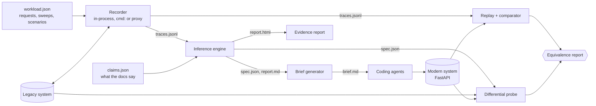

# Software Archaeology Engine

**Rewrite a legacy system from what it actually does, not from what its documentation says, and prove the rewrite is equivalent.**

Rewrites usually fail on behaviour nobody wrote down: the discount that starts at 101 units instead of 100, the error that comes back as HTTP 200, the quantity that is silently clamped. Documentation describes what the system was meant to do. Users depend on what it does.

This engine treats the running system as the only trustworthy specification:

1. **Excavate**: record the legacy system's real requests and responses.
2. **Interpret**: infer its true behaviour from the recordings, and test every documented claim against that evidence.
3. **Rebuild**: hand coding agents a brief built only from evidence. They never see the legacy source or docs.
4. **Prove**: replay every recorded exchange against the rebuild, then probe both systems with fresh inputs nobody recorded.

It ships with two legacy systems to excavate, each with wrong documentation and an answer key, and a rebuild of each that a coding agent wrote from the evidence alone:

| | ACME Billing | Pinecrest Library |
| --- | --- | --- |
| Legacy system | Python WSGI, stateless | Node.js, stateful, multi-step |
| Recorded exchanges | 3,226 | 1,115 (incl. 7 multi-step scenarios) |
| Documented claims contradicted | 7 of 9 | 10 of 13 |
| Rebuild (FastAPI, from the brief only) | 3,226 / 3,226 replay | 1,115 / 1,115 replay, 821 ids remapped |
| Differential probe | 3,000 / 3,000 agree | 5,007 / 5,007 agree (incl. 300 fresh scenario runs) |

## What it finds

### ACME Billing

Run on the bundled legacy service, **ACME Billing**, the engine recovers every planted behaviour from traffic alone:

```text
Documentation vs reality
  C1  Unknown SKUs return HTTP 404.                           CONTRADICTED  status: expected 404, observed 200
  C3  Orders of 100 or more units receive a 10% discount.     CONTRADICTED  bulk_discount_pct: expected 10, observed 0
  C4  Totals are rounded to the nearest cent.                 CONTRADICTED  total: expected '0.32', observed '0.31'
  C5  Invalid or expired coupons return INVALID_COUPON.       CONTRADICTED  error: expected 'INVALID_COUPON', observed <missing>
  C8  Quantities above 1000 are rejected with HTTP 400.       CONTRADICTED  status: expected 400, observed 200
  ... 7 of 9 documented claims are false

Hidden behaviour
  GET /quote (sku=WIDGET): bulk_discount_pct is 0 for qty 1-100, 10 for qty 101-499, 15 for qty 500-1500
  GET /quote (sku=WIDGET): qty follows the input up to 1000, then stays at 1000
  GET /quote: sku is case-insensitive (24 request pairs differing only by case gave identical responses)
  GET /quote: coupon is whitespace-trimmed (11 request pairs differing only by surrounding whitespace ...)

Volatile fields
  POST /invoice  invoice_id, created_at  (vary across identical requests)
```

A coding agent then rebuilt the service in FastAPI from the generated brief alone, and the result is proven equivalent:

```text
== 4. Prove: replaying recorded traffic ==
**3226 / 3226 responses equivalent (100.0%)**    Verdict: EQUIVALENT

== 5. Probe: 3000 fresh requests the recording never contained ==
**3000 / 3000 fresh requests agree (100.0%)**    Verdict: NO DIVERGENCE FOUND
```

### Pinecrest Library: a stateful system in another language

Pinecrest is a lending library written in Node.js. A client creates a member, borrows books with the id the server handed back, and returns them, sometimes late. The rules depend on state (how many books a member holds), dates and money, and the ids are random. The engine records it as a child process over HTTP. It drives multi-step **scenarios** whose later steps use earlier answers, and reads the rules off the evidence:

```text
Documentation vs reality
  L5   All loans are due 14 days after borrowing.              CONTRADICTED  due_on: expected '2026-01-19', observed '2026-02-02'
  L6   A member may have at most 3 books on loan.              CONTRADICTED  status: expected 409, observed 201
  L7   Late returns cost 0.50 per day from the first day late. CONTRADICTED  fee: expected '1.00', observed '0.00'
  L8   There is no maximum late fee.                           CONTRADICTED  fee: expected '27.50', observed '10.00'
  L9   Returning a loan twice returns 409 ALREADY_RETURNED.    CONTRADICTED  status: expected 409, observed 200
  ... 10 of 13 documented claims are false

Hidden behaviour
  late-return steps 2, 3 (POST /loans/{id}/return): fee is 0.00 from 2026-01-10 to 2026-01-21;
      0.75 at 2026-01-22 rising 0.25 per day to 10.00 at 2026-02-28; 10.00 from 2026-03-01 to 2026-03-15
  fees-block step 3 (POST /loans): response shape is '201 ...' for returned_on up to 2026-02-07, '403 error' from 2026-02-08
  GET /books: per_page follows the input up to 50, then stays at 50
  POST /loans: isbn is separator-insensitive (5 request pairs differing only by hyphens or spaces gave identical responses)

Identifier flows
  member_id from POST /members is sent to POST /loans as param member_id (216 times)
  loan_id from POST /loans is sent to POST /loans/{id}/return as path (331 times)
```

The fee line is the whole late-fee rule recovered exactly, with no source code: a 2-day grace period, 0.25 per day after that, and a 10.00 cap. The engine fits exact piecewise-linear segments with decimal arithmetic over the return date that was varied two requests earlier in each run.

Replay against a stateful rebuild cannot compare ids literally, because the rebuild hands out its own. Replay keeps an **identity map**: once the legacy system said `L-04b7e2` and the rebuild said `L-9c1f30` in the same place, later requests are sent with the rebuild's id and later responses are compared through the map. The probe runs fresh scenario runs in lockstep against both systems, each side with its own captured ids.

[`modern_library/REBUILD_NOTES.md`](modern_library/REBUILD_NOTES.md) lists what the evidence left open for the rebuild agent, such as whether borrowing is blocked by a fee amount or by days late, since both fit the recording. A mutation test changes one business rule of the rebuild at a time by a small amount (fee cap, grace days, fee step, block threshold, loan limit, page cap). Replay fails for every one of them.

## Why replay alone is not enough

The first rebuild replayed the original 1,495 recordings at 100%, yet disagreed with the legacy system on 2.5% of fresh inputs. It truncated money to the cent after every discount; the legacy system truncates once. No recorded request combined a coupon with a bulk quantity, so the recording could not tell the two rules apart.

Differential probing (`archaeology probe`) generates new requests from the inferred spec and sends each one to both systems. It found the gap, the workload was widened, replay then failed on 372 exchanges, and the agent corrected the arithmetic from the new evidence. CI now fails on any replay mismatch **or** any probe divergence. The full story is in [#15](../../issues/15).

## Architecture



| Stage | Module | What it does |
| --- | --- | --- |
| Excavate | `archaeology/recorder`, `archaeology/scenarios.py` | Drives a declarative workload of explicit requests, parameter sweeps and multi-step scenarios (captures, `{{vars}}`, varied values incl. date ranges) against any target. `RecordingMiddleware` wraps a WSGI app. `archaeology proxy` records real traffic to a live system in any language. |
| Interpret | `archaeology/infer` | `catalog` (endpoints, opaque-id path templates, types incl. dates, response shapes), `volatility` (generated ids and timestamps, compared only at like positions so legitimate state changes are not noise), `boundaries` (step changes, clamps, shape changes and exact piecewise-linear rules along int or date inputs, per scenario step), `flows` (which response field feeds which later request), `normalization` (case, whitespace and separator insensitivity), `claims` (documentation tested against evidence). |
| Rebuild | `archaeology/brief.py` | Turns the spec and traces into the agent brief: every rule the evidence shows, contracts, identifier flows and id formats, rule tables, documentation errors, real exchanges on both sides of every boundary, and complete scenario runs. |
| Prove | `archaeology/replay`, `archaeology/probe.py` | Replays traces in order against an in-process WSGI or ASGI app, a `cmd:` process or a live URL, with an identity map for generated ids and a structural JSON diff that ignores volatile fields. Probes both systems with seeded fresh requests and fresh scenario runs. |
| Report | `archaeology/html_report.py` | One self-contained HTML page: claims vs reality, hidden behaviours with SVG evidence charts drawn from the traces, flows, and replay and probe verdicts. CI publishes it for both systems. |

All stages share one contract, the JSON Lines trace format in [`archaeology/trace.py`](archaeology/trace.py). Design rationale is in [docs/DESIGN.md](docs/DESIGN.md).

## Quickstart

```bash
python -m pip install -e ".[dev]"
python -m archaeology demo                                   # all stages on ACME Billing; artefacts in out/
python -m archaeology demo --system library --out out/library  # Pinecrest Library (needs Node.js 18+)
python -m pytest                                             # the full suite (library tests skip without node)
```

Or stage by stage:

```bash
archaeology record --app legacy_app.billing:make_app --workload legacy_app/workload.json --out out/traces.jsonl
archaeology infer  --traces out/traces.jsonl --claims legacy_app/claims.json --spec out/spec.json --report out/report.md
archaeology brief  --spec out/spec.json --traces out/traces.jsonl --out out/brief.md --name "ACME Billing"
archaeology replay --traces out/traces.jsonl --target modern_app.main:make_app --spec out/spec.json
archaeology probe  --reference legacy_app.billing:make_app --candidate modern_app.main:make_app \
                   --spec out/spec.json --traces out/traces.jsonl
```

For a system in another language, start it as a target and add `--workload` to probe its scenarios:

```bash
archaeology record --target "cmd:node legacy_library/server.js" --workload legacy_library/workload.json --out out/lib.jsonl
archaeology infer  --traces out/lib.jsonl --claims legacy_library/claims.json --spec out/lib-spec.json --report out/lib.md
archaeology probe  --reference "cmd:node legacy_library/server.js" --candidate modern_library.main:make_app \
                   --spec out/lib-spec.json --traces out/lib.jsonl --workload legacy_library/workload.json
archaeology report --spec out/lib-spec.json --traces out/lib.jsonl --title "Pinecrest Library" --out out/lib.html
archaeology proxy  --upstream http://legacy.internal:8080 --listen 127.0.0.1:8080 --out out/live.jsonl
```

`--target`, `--reference` and `--candidate` accept `module:attr` (a WSGI app, an ASGI app such as FastAPI, or a `make_*` factory for fresh state), `cmd:<command>` (a process that listens on `$PORT`), or an `http(s)://` base URL.

## How it was built

The project was developed as an agent-driven software lifecycle: a planning agent wrote the design, opened an issue per component (grouped into GitHub milestones) and reviewed and merged every pull request once CI passed; coding agents implemented the components in parallel. Each rebuild agent worked in an isolated workspace that contained only the brief, the recorded traces and the replay tool. The Pinecrest rebuild passed replay on its first attempt. The commit history and pull requests show each step.

## Layout

```
archaeology/        the engine: trace format, recorder, infer, brief, replay, probe, CLI
legacy_app/         ACME Billing: the legacy system, its (wrong) docs, claims, workload, answer key
legacy_library/     Pinecrest Library: a stateful Node.js system, its (wrong) docs, claims, scenarios, answer key
modern_app/         the FastAPI rebuild of ACME Billing, produced from the brief
modern_library/     the FastAPI rebuild of Pinecrest Library, produced from the brief, with notes
tests/              unit tests per stage, answer-key scoring, rebuild tests
docs/DESIGN.md      problem, principles, architecture, milestones
```

## Roadmap

- Targeted probing: generate requests for claims the recording never tested, and binary-search suspected boundaries instead of sweeping.
- Close the open questions automatically: turn each ambiguity a rebuild agent reports into a new scenario, record it, and re-check.
- Closed agent loop: an orchestrator that feeds replay and probe diffs back to the rebuild agents until both pass.
- Concurrency: record interleaved clients and check the rebuild under the same interleavings.
