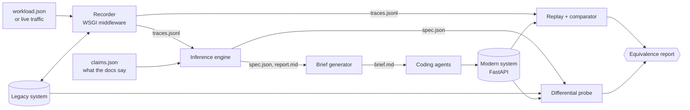

# Software Archaeology Engine

**Rewrite a legacy system from what it actually does, not from what its documentation says, and prove the rewrite is equivalent.**

Rewrites usually fail on behaviour nobody wrote down: the discount that starts at 101 units instead of 100, the error that comes back as HTTP 200, the quantity that is silently clamped. Documentation describes what the system was meant to do. Users depend on what it does.

This engine treats the running system as the only trustworthy specification:

1. **Excavate**: record the legacy system's real requests and responses.
2. **Interpret**: infer its true behaviour from the recordings, and test every documented claim against that evidence.
3. **Rebuild**: hand coding agents a brief built only from evidence. They never see the legacy source or docs.
4. **Prove**: replay every recorded exchange against the rebuild, then probe both systems with fresh inputs nobody recorded.

## What it finds

Run on the bundled legacy service, **ACME Billing**, the engine recovers every planted behaviour from traffic alone:

```text
Documentation vs reality
  C1  Unknown SKUs return HTTP 404.                           CONTRADICTED  status: expected 404, observed 200
  C3  Orders of 100 or more units receive a 10% discount.     CONTRADICTED  bulk_discount_pct: expected 10, observed 0
  C4  Totals are rounded to the nearest cent.                 CONTRADICTED  total: expected '0.32', observed '0.31'
  C5  Invalid or expired coupons return INVALID_COUPON.       CONTRADICTED  error: expected 'INVALID_COUPON', observed <missing>
  C8  Quantities above 1000 are rejected with HTTP 400.       CONTRADICTED  status: expected 400, observed 200
  ... 7 of 9 documented claims are false

Hidden behaviour
  GET /quote (sku=WIDGET): bulk_discount_pct is 0 for qty 1-100, 10 for qty 101-499, 15 for qty 500-1500
  GET /quote (sku=WIDGET): qty follows the input up to 1000, then stays at 1000
  GET /quote: sku is case-insensitive (24 request pairs differing only by case gave identical responses)
  GET /quote: coupon is whitespace-trimmed (11 request pairs differing only by surrounding whitespace ...)

Volatile fields
  POST /invoice  invoice_id, created_at  (vary across identical requests)
```

A coding agent then rebuilt the service in FastAPI from the generated brief alone, and the result is proven equivalent:

```text
== 4. Prove: replaying recorded traffic ==
**3226 / 3226 responses equivalent (100.0%)**    Verdict: EQUIVALENT

== 5. Probe: 3000 fresh requests the recording never contained ==
**3000 / 3000 fresh requests agree (100.0%)**    Verdict: NO DIVERGENCE FOUND
```

## Why replay alone is not enough

The first rebuild replayed the original 1,495 recordings at 100%, yet disagreed with the legacy system on 2.5% of fresh inputs. It truncated money to the cent after every discount; the legacy system truncates once. No recorded request combined a coupon with a bulk quantity, so the recording could not tell the two rules apart.

Differential probing (`archaeology probe`) generates new requests from the inferred spec and sends each one to both systems. It found the gap, the workload was widened, replay then failed on 372 exchanges, and the agent corrected the arithmetic from the new evidence. CI now fails on any replay mismatch **or** any probe divergence. The full story is in [#15](../../issues/15).

## Architecture



| Stage | Module | What it does |
| --- | --- | --- |
| Excavate | `archaeology/recorder` | `RecordingMiddleware` wraps any WSGI app and writes one trace per exchange; the exerciser drives a declarative workload of explicit requests and parameter sweeps. |
| Interpret | `archaeology/infer` | `catalog` (endpoints, path templates, parameter types, response shapes), `volatility` (generated ids and timestamps), `boundaries` (step changes, clamping, shape changes along numeric inputs), `normalization` (case- and whitespace-insensitive inputs), `claims` (documentation tested against evidence). |
| Rebuild | `archaeology/brief.py` | Turns the spec and traces into the agent brief: contracts, hidden behaviour, documentation errors, and real exchanges on both sides of every boundary. |
| Prove | `archaeology/replay`, `archaeology/probe.py` | Replays traces against in-process WSGI or ASGI apps or a live URL, with a structural JSON diff that ignores volatile fields; probes both systems with seeded fresh requests. |

All stages share one contract, the JSON Lines trace format in [`archaeology/trace.py`](archaeology/trace.py). Design rationale is in [docs/DESIGN.md](docs/DESIGN.md).

## Quickstart

```bash
python -m pip install -e ".[dev]"
python -m archaeology demo            # all five stages on ACME Billing; artefacts in out/
python -m pytest                      # the full suite, including the answer-key scoring test
```

Or stage by stage:

```bash
archaeology record --app legacy_app.billing:make_app --workload legacy_app/workload.json --out out/traces.jsonl
archaeology infer  --traces out/traces.jsonl --claims legacy_app/claims.json --spec out/spec.json --report out/report.md
archaeology brief  --spec out/spec.json --traces out/traces.jsonl --out out/brief.md --name "ACME Billing"
archaeology replay --traces out/traces.jsonl --target modern_app.main:make_app --spec out/spec.json
archaeology probe  --reference legacy_app.billing:make_app --candidate modern_app.main:make_app \
                   --spec out/spec.json --traces out/traces.jsonl
```

`--target`, `--reference` and `--candidate` accept `module:attr` (a WSGI app, an ASGI app such as FastAPI, or a `make_*` factory for fresh state) or an `http(s)://` base URL.

## How it was built

The project was developed as an agent-driven software lifecycle: a planning agent wrote the design, opened an issue per component and reviewed and merged every pull request; coding agents implemented the components in parallel. The rebuild agent worked in an isolated workspace that contained only the brief, the recorded traces and the replay tool. The commit history and pull requests show each step.

## Layout

```
archaeology/        the engine: trace format, recorder, infer, brief, replay, probe, CLI
legacy_app/         ACME Billing: the legacy system, its (wrong) docs, claims, workload, answer key
modern_app/         the FastAPI rebuild produced from the brief
tests/              unit tests per stage, answer-key scoring, rebuild tests
docs/DESIGN.md      problem, principles, architecture, milestones
```

## Roadmap

- Recording reverse proxy, so systems in any language can be excavated over HTTP.
- Active boundary refinement: binary-search a suspected boundary instead of sweeping.
- Stateful behaviour: infer request sequences (create then read) and replay them with state resets.
- Closed agent loop: an orchestrator that feeds replay and probe diffs back to the rebuild agents until both pass.
